# Cybersecurity Lab Setup: Kali Linux on VirtualBox

**Networkwalks Cybersecurity Internship | Batch B084 | Week 1, Project 1**


## What this project is

This is my Week 1 project for the Networkwalks internship: a small, isolated lab on my own laptop where I can practise security tools.

The lab is one Kali Linux machine on a private VirtualBox NAT network. It has a fixed address, a shared folder and shared clipboard with my host, and working internet access. I can add more machines to the same network later.

## Requirements and how I met them

| Requirement | What I did |
|---|---|
| VirtualBox as the base | VirtualBox was already installed on my laptop (version in Figure 1) |
| Kali Linux as the attacking machine | Kali Linux 2026.1, in a VM called `kali-NW` |
| NAT Network in 10.0.0.0/24 | Created `NatNetwork` as 10.0.0.0/24 |
| Clipboard and drag and drop on | Set both to Bidirectional in the VM settings (Figure 6) |
| Host Downloads folder shared | Shared with full access and auto-mount |
| Kali IP address 10.0.0.2/24 | Set manually in NetworkManager, gateway 10.0.0.1 |
| Full internet access | Tested with ping after fixing a connectivity problem (Figure 9) |
| Snapshot | Took a snapshot named "My fresh Kali Install" |

## Lab overview

| Item | Setting |
|---|---|
| Host | Windows laptop, 16 GB RAM, 4 cores / 8 threads |
| Hypervisor | Oracle VirtualBox |
| Attacker VM | `kali-NW`, Kali Linux 2026.1 |
| Memory | 2048 MB |
| Network | NAT Network `NatNetwork`, 10.0.0.0/24 |
| Kali address | 10.0.0.2/24, gateway 10.0.0.1 |
| Network adapter | Intel PRO/1000 MT Desktop, promiscuous mode: Allow All |
| Shared folder | Host Downloads, full access, auto-mount |

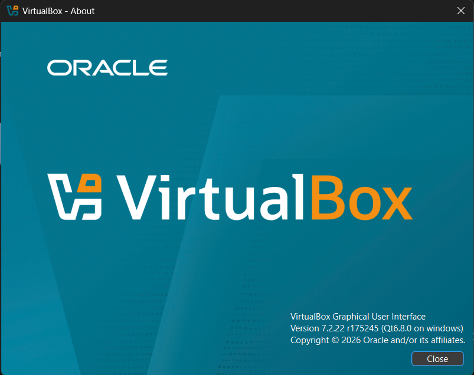

*Figure 1: VirtualBox version*

## Step by step

### 1. Create the NAT Network

In VirtualBox, under Tools and Network, I created a NAT Network called `NatNetwork` with the prefix 10.0.0.0/24 and DHCP enabled. Every VM in the lab will connect to this network.

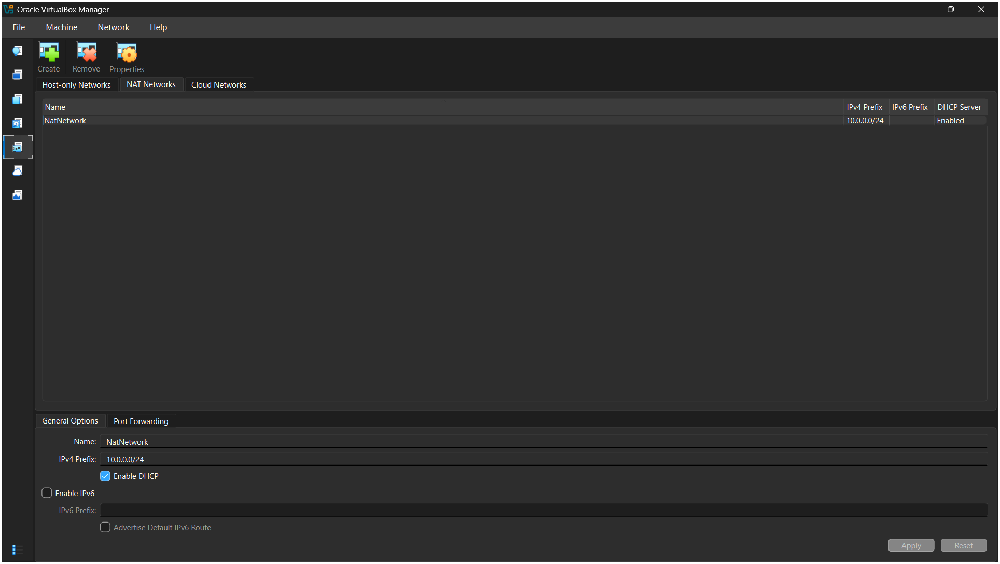

*Figure 2: NatNetwork, 10.0.0.0/24, DHCP enabled*

### 2. Create the Kali VM

I already had VirtualBox and a Kali VM, so instead of downloading another image I made a full clone of my existing Kali VM and named it `kali-NW`. Then I followed the rest of the lab guide on the clone.

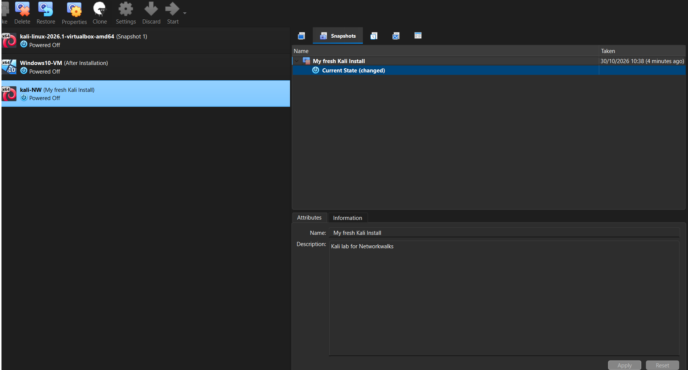

*Figure 3: The kali-NW VM in VirtualBox*

### 3. Configure the VM settings

I set the VM's memory, checked that hardware virtualization was on, attached the network adapter to the NAT Network, and shared my host's Downloads folder.

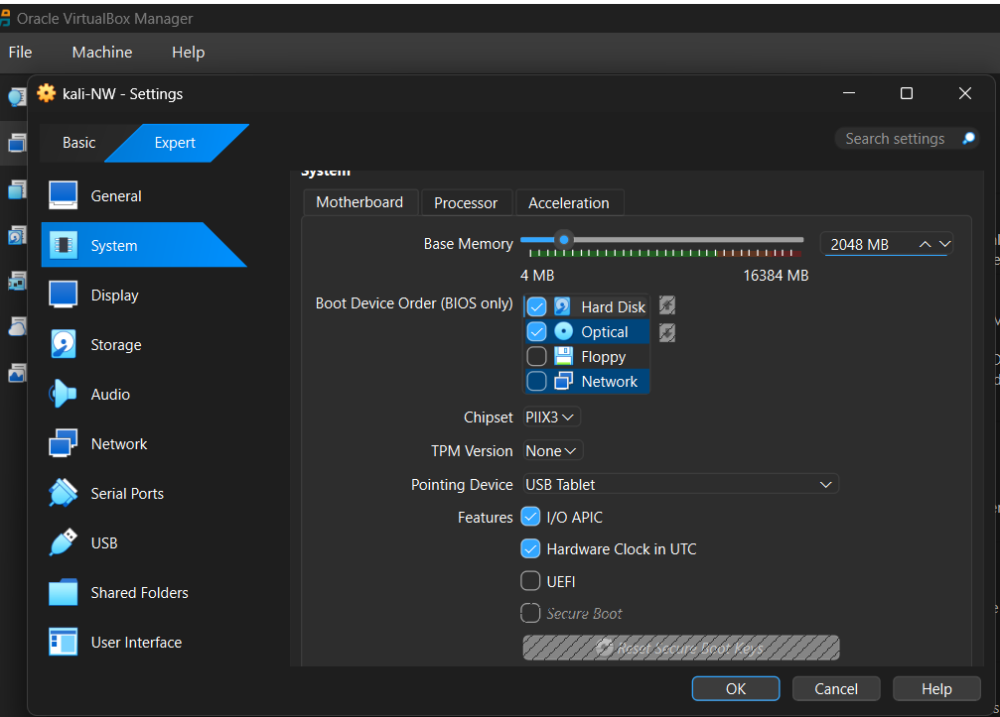

*Figure 4: System settings, 2048 MB of memory*

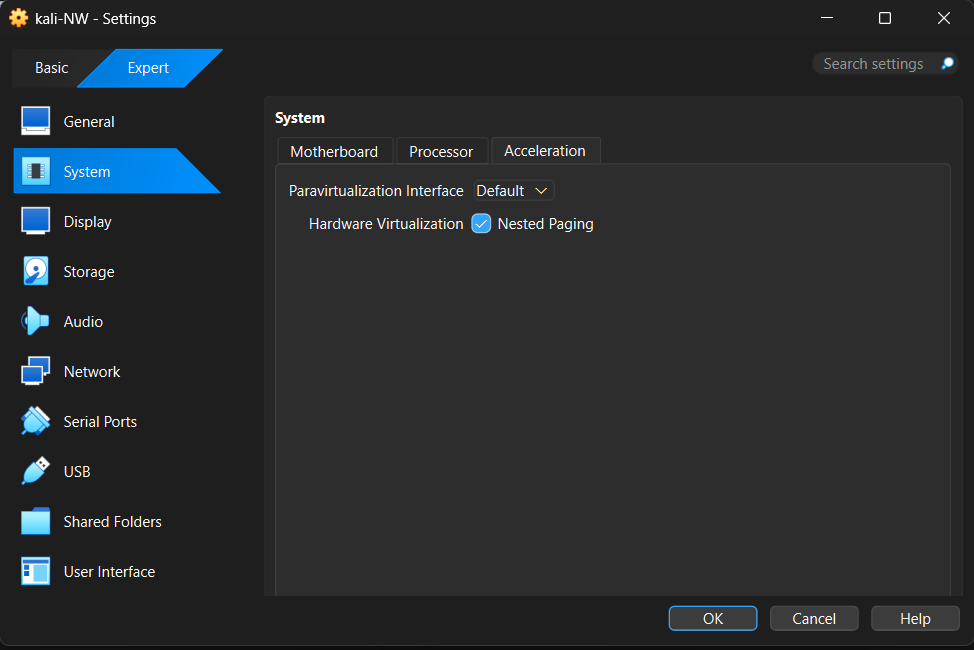

*Figure 5: Hardware virtualization and nested paging enabled*

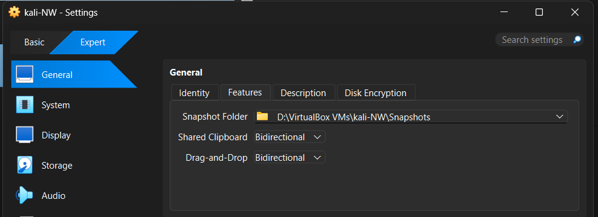

*Figure 6: Shared clipboard and drag and drop set to Bidirectional*

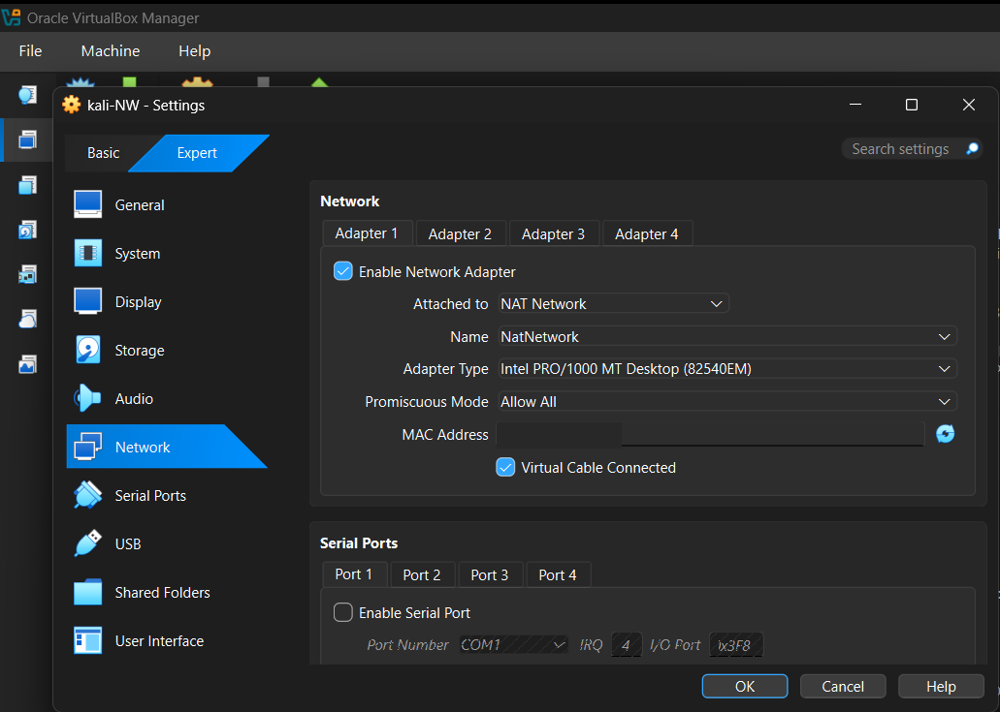

*Figure 7: Adapter 1 attached to NatNetwork, promiscuous mode on Allow All*

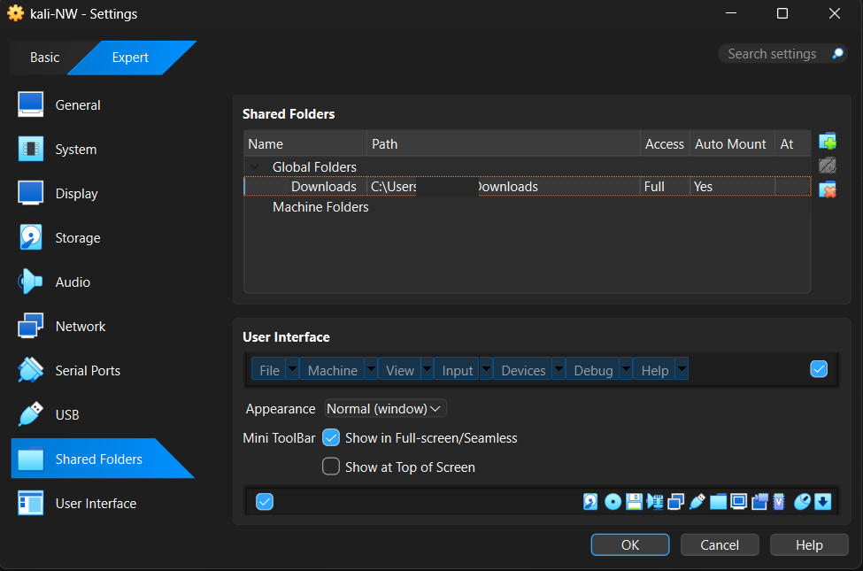

*Figure 8: Host Downloads folder shared with full access and auto-mount*

### 4. Set the static IP

Inside Kali I opened the network connection settings and switched the IPv4 method to Manual: address 10.0.0.2, netmask 24, gateway 10.0.0.1, DNS 10.0.0.1.

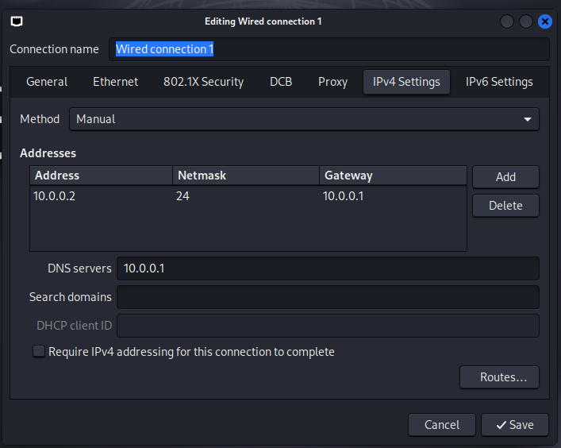

*Figure 9: Manual IPv4 settings in NetworkManager*

### 5. Check the address and internet access

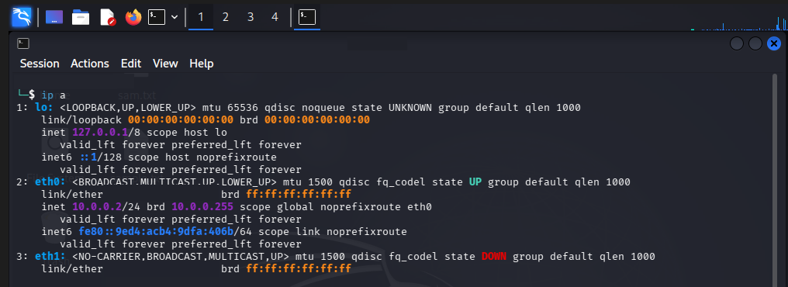

*Figure 10: `ip a` showing 10.0.0.2/24*

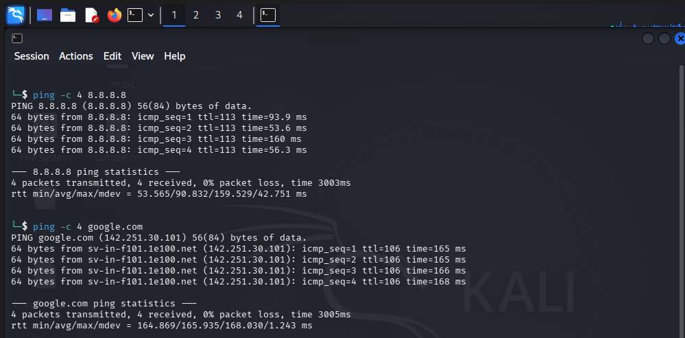

*Figure 11: Ping test confirming internet access*

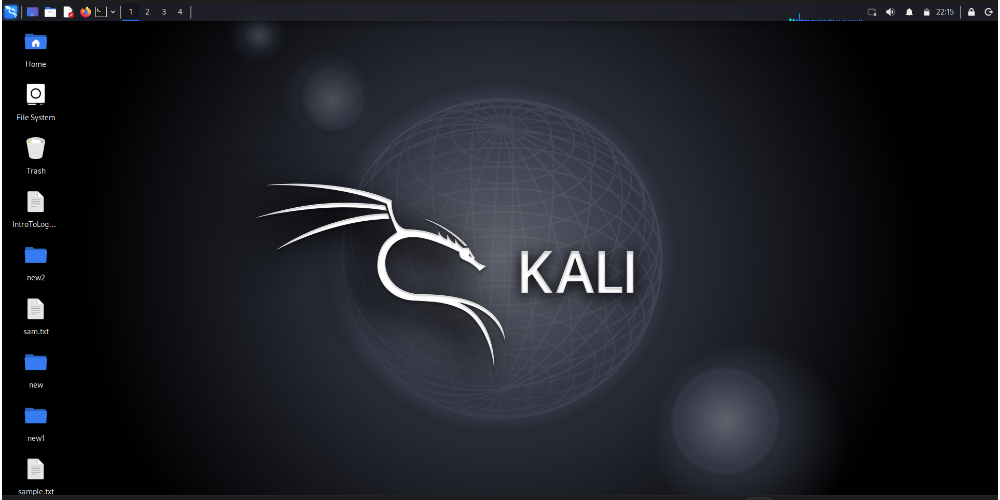

*Figure 12: The Kali desktop running on the new network*

### 6. Take a snapshot

Once everything worked, I took a snapshot called "My fresh Kali Install", so I can roll back if I break the lab later.

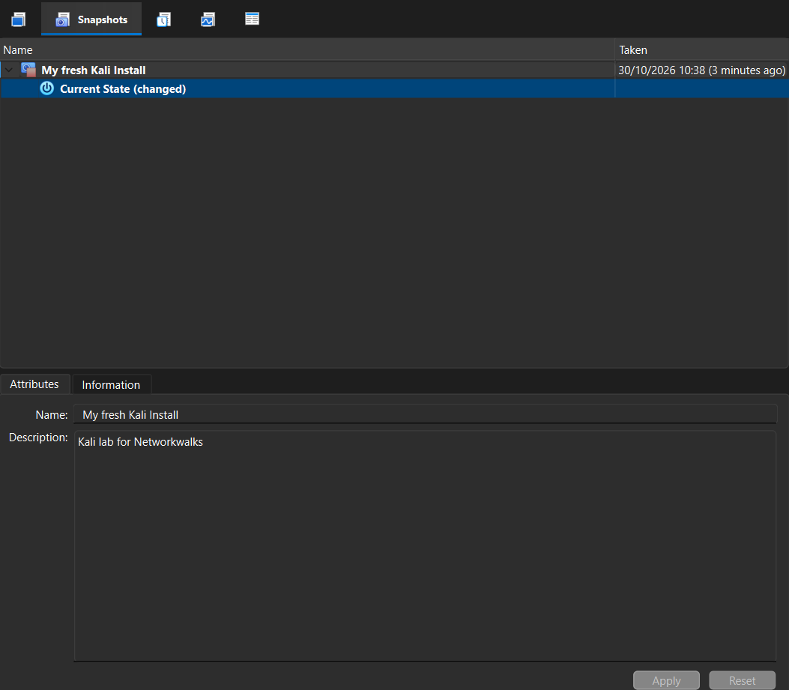

*Figure 13: Snapshot taken after the setup*

## The problem I hit: connectivity

After moving Kali onto the NAT Network and setting the static address, I had connectivity problems. The lab guide says this is a known issue with newer VirtualBox 7 and Kali 2026.1 setups, and it gives a checklist, which I followed:

1. Checked that the NAT Network was created correctly.
2. Checked all the network settings.
3. Made sure no other VM on the same network was using 10.0.0.2.
4. Ran the three commands from the guide, then restarted Kali:

```bash
sudo nmcli connection modify "Wired connection 1" ipv4.dad-timeout 0
sudo nmcli connection down "Wired connection 1"
sudo nmcli connection up "Wired connection 1"
```

5. Pointed the DNS server at the network gateway (10.0.0.1).

After that, the ping tests worked.

## What I learned

- A NAT Network keeps VMs on a private network where they can reach each other and still get internet access, which a plain NAT adapter doesn't do.
- A static IP is only half the job. Without a working gateway and DNS, the machine has an address but no internet.
- A snapshot taken at the right moment makes it much cheaper to experiment.

## Next step

Add a Windows machine to the same NAT Network and run ping tests between the two VMs.
